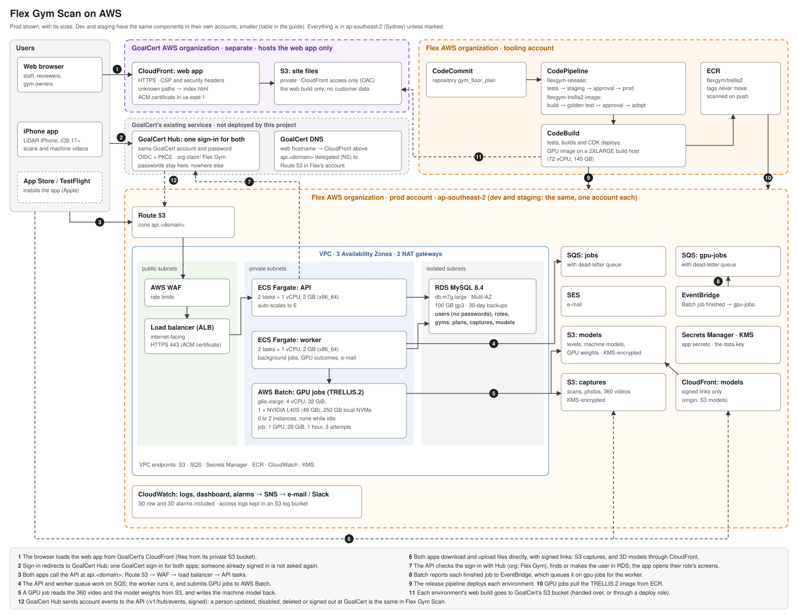

# Deploying Flex Gym Scan

The backend and everything behind the iPhone app run in **Flex's AWS organization**, sign-in included: every user's account and password is in Amazon Cognito there. Only the web app's front end is hosted in **GoalCert's AWS organization**, separately. TRELLIS.2 makes the machine models, in Flex's AWS. This guide covers all of it, step by step, with a task list for each team at the end.

**Who it is for:**
- Flex's AWS team, which owns the Flex accounts;
- GoalCert's AWS team, which hosts the web app's front end and runs GoalCert's DNS;
- Thomas, who owns the app and infrastructure code;
- Tejesh, who owns the 3D work and TRELLIS.2;
- the company's management and Legal, for two licence questions and the Apple account.

**How to use it.** Parts 2 to 5 are the steps, in order, each with who does it, what it needs, what to do, and how to know it is done. Part 6 regroups the same steps as one checklist per team. Part 7 records what was checked before this code was merged, and the gaps that check found.

The detailed how-to for single steps lives in the runbooks (`docs/runbooks/`); this guide links to them rather than repeating them.

**Placeholders.** Domains and account numbers in `infra/cdk.json` are still placeholders, `goalcert.example` included. The real ones come from GoalCert's team and the product owner (2.1).

**Sign-in is moving to Amazon Cognito.** That is decided, and Thomas is making the change. Until it is made, the merged code still signs in through GoalCert Hub. This guide describes the Cognito design, and Part 1 lists exactly what changes.

---

## Part 1. Where everything runs



The diagram shows prod. Dev and staging are the same components, each in its own account, at these sizes (from `infra/cdk.json`):

| | Dev | Staging | Prod |
|---|---|---|---|
| API (ECS Fargate, x86_64) | 1 task × 0.5 vCPU, 1 GB; up to 2 | 1 task × 0.5 vCPU, 1 GB; up to 3 | 2 tasks × 1 vCPU, 2 GB; up to 6 |
| Worker (ECS Fargate, x86_64) | 1 task × 0.5 vCPU, 1 GB | 1 task × 0.5 vCPU, 1 GB | 2 tasks × 1 vCPU, 2 GB |
| Database (RDS MySQL 8.4, gp3) | db.t4g.micro, 20 GB, one zone, 7-day backups | db.t4g.small, 20 GB, one zone, 7-day backups | db.m7g.large, 100 GB, Multi-AZ, 30-day backups |
| GPU (AWS Batch, g6e.xlarge) | 0 to 1 instance | 0 to 1 instance | 0 to 2 instances |
| NAT gateways | 1 | 1 | 2 |
| Logs kept | 30 days | 30 days | 365 days |

A GPU instance is a `g6e.xlarge`: 4 vCPUs, 32 GiB, one NVIDIA L40S (48 GB), and a 250 GB local NVMe disk that holds the weights between jobs. A job gets 1 GPU and 28 GiB, for at most an hour, with 3 attempts.

| Piece | Where | Holds customer data? |
|---|---|---|
| API and background worker (ECS Fargate), database (RDS MySQL), storage (S3), queues (SQS) | Flex's AWS, one account per environment (dev, staging, prod), Sydney (`ap-southeast-2`) | Yes, in Sydney only (`docs/residency.md`) |
| GPU jobs for machine models (AWS Batch, `g6e.xlarge`), and the models CDN (CloudFront with signed links) | Flex's AWS, the same environment accounts | Yes (machine videos and models), in Sydney |
| Pipelines (release, TRELLIS.2 image), image repository (ECR), the code (CodeCommit `gym_floor_plan`) | Flex's AWS, the tooling account | No |
| Sign-in: Amazon Cognito user pool, with every user's account and password | Flex's AWS, each environment account, Sydney | Yes: accounts, in Sydney only |
| Mail (SES), alarms, dashboards | Flex's AWS, environment accounts | Mail only |
| **Web app** (static files: S3 and CloudFront) | **GoalCert's AWS organization**, one site per environment | No: only the app's own code |
| DNS for the GoalCert domains | GoalCert, existing: two records for this project | No |
| iPhone app | Apple: TestFlight, then the App Store. It talks only to the API. | On the phone, until uploaded |

**How the pieces talk:**
- **The web app**, served from GoalCert's CloudFront, calls the API in Flex's AWS at `https://api.<environment domain>`. The API accepts calls from that one web origin only (`PUBLIC_WEB_URL`).
- **Browsers fetch files directly from Flex's storage**, through signed links: scans and photos from S3, 3D models from the models CDN. Both allow the same web origin.
- **The iPhone app** calls the same API, and uploads straight to S3 through signed links.
- **Sign-in** is Amazon Cognito, in Flex's AWS, for both the web app and the iPhone app.
- **The GPU work** is started by the backend, inside Flex's AWS. It has no endpoint and no key; AWS IAM roles give each part only what it needs.

### Users, sign-in and passwords

Everything about the users stays in Flex's AWS. GoalCert holds nothing about them.

| What | Where it lives |
|---|---|
| A person's account and password | Amazon Cognito, in Flex's AWS (Sydney), and nowhere else. People type their password on Cognito's sign-in page. Flex's own code never sees it. |
| The person in Flex Gym Scan: their Cognito id, email and name; the gyms they belong to; Flex staff roles (reviewer, admin); their sessions | Flex's database, in Flex's AWS (Sydney). |
| Everything they make: plans, scans, photos, videos, 3D models, approvals, the audit log | Flex's AWS only (Sydney). |
| GoalCert's AWS | Nothing about them: only the web app's code. The browser downloads it, then signs in and works only with Flex's AWS. |

**One sign-in for both apps.** The same account signs in to the web app and the iPhone app.

**How signing in works.** It is a redirect:
1. The app sends the browser, or the iPhone's sign-in sheet, to Cognito's sign-in page, in Flex's AWS.
2. The person signs in with their email and password, and MFA if they turned it on. Someone already signed in on that browser or phone is not asked again.
3. Cognito sends them back to the app with a one-time code.
4. The app gives the code to Flex's API, which checks it with Cognito, finds the person's record, and starts their session.
5. The app opens the screens for their role: gym owners and their staff see their plans, Flex reviewers the review queue, admins the admin pages.

**How people get an account.** There is no open sign-up:
- An invite, from a gym's owner or from Flex staff, creates the person's account in Cognito.
- Cognito emails them a temporary password, which they replace at their first sign-in.
- "Forgot your password?" is on the sign-in page.

### Sign-in with Amazon Cognito: what changes in the code

**Who.** Thomas (sign-in is his code).

The merged code signs in through GoalCert Hub. Cognito uses the same standard (OpenID Connect, with PKCE), so most of the code stays as it is. These are the changes:

**Infrastructure** (each Flex environment account):
1. **A Cognito user pool** in `ap-southeast-2`:
   - sign-in with email;
   - no self sign-up: accounts are made by invites only;
   - a password policy, and optional MFA with an authenticator app;
   - account recovery by email, with mail sent through the environment's SES identity;
   - deletion protection in prod.
2. **Cognito's sign-in page**, on a domain prefix (`flexgym-<env>`). A custom domain such as `signin.<domain>` can come later; it needs a certificate in `us-east-1` and a DNS record.
3. **One app client for both apps:**
   - a client secret, which only the API holds;
   - the authorization code flow, with PKCE;
   - scopes `openid profile email`;
   - callback URLs: the web app's `https://<web hostname>/auth/callback`, and the iPhone app's redirect URI;
   - sign-out URLs for both.
4. **The backend's sign-in settings**, taken from the pool in place of `cdk.json`'s `hub` block:
   - issuer: `https://cognito-idp.ap-southeast-2.amazonaws.com/<pool id>`;
   - authorize and token URLs on the sign-in domain (`/oauth2/authorize`, `/oauth2/token`);
   - JWKS: `<issuer>/.well-known/jwks.json`;
   - the client id, and the client secret through Secrets Manager.
5. **The API's permission to manage users in that pool:** `cognito-idp:AdminCreateUser`, `AdminGetUser`, `AdminDisableUser`, `AdminEnableUser` and `AdminUserGlobalSignOut`.

**Backend:**
1. Drop the GoalCert-only check of an `org` claim: Cognito sends none, and access already depends on Flex memberships, invites and staff roles.
2. Read Cognito's ID token as it comes: `email_verified`, `name` when set, and no `sid`.
3. An invite creates the person's Cognito account if there is none (`AdminCreateUser`, which emails a temporary password). As today, the invite is linked at their first sign-in, by verified email.
4. Removing a user in Flex admin also disables them in Cognito and signs them out everywhere.
5. Signing out of Flex Gym Scan also ends the Cognito session (its sign-out URL). Otherwise the next sign-in on that browser would skip the password.
6. Retire the GoalCert account-events endpoint (`/v1/hub/events`) and its secret.
7. **The first admin.** No screen can make the first one:
   - create their Cognito account once, in the AWS console or with the CLI;
   - let them sign in;
   - give them the admin role with a one-off database update, run like the migrations.

   From then on, admins make other staff in the app.

**Web app:** wording only. "Sign in with GoalCert" becomes "Sign in", and the help text and the "no access" message change. The flow reads the sign-in addresses from the API, so it does not change.

**iPhone app:** wording only, on the sign-in screen and the forgotten-password hint. "Forgot your password?" is on Cognito's page. The flow reads the addresses from the API, and its redirect URI is registered in the app client.

**Tests.** The stand-in sign-in service, used locally and in tests, stays. Add tests that invites make Cognito accounts and removals disable them, against a fake.

**Done when**, on staging:
- one account signs in to both the web app and the iPhone app;
- an invite emails the person a temporary password;
- removing them stops their sign-in.

---

## Part 2. Flex's AWS: the backend

The release machinery is written: CDK in `infra/`, and the pipeline `flexgym-release`. The detailed runbook is `docs/runbooks/deploy.md`.

### 2.1 Settle the accounts, domains and sign-in values

**Who:**
- Flex's AWS team: the accounts.
- GoalCert's team: the domains.
- Thomas: filling them into `infra/cdk.json`.

**Steps:**
1. **Accounts.** In Flex's AWS organization: one tooling account (pipelines, ECR, CodeCommit), and one account each for dev, staging and prod. Give the team access to each, through IAM Identity Center or the organization's usual way.
2. **Domains**, per environment:
   - the web app's hostname, hosted by GoalCert (for example `gym.goalcert.example`);
   - the API's hostname (for example `api.gym.goalcert.example`), whose DNS zone lives in Flex's account, delegated from GoalCert's DNS (2.4).
3. **Sign-in.** Thomas sets up Cognito in each environment ("Sign-in with Amazon Cognito", Part 1). Its two callback URLs are the web app's `https://<web hostname>/auth/callback` and the iPhone app's redirect URI.
4. **Fill in `infra/cdk.json`**, per environment:
   - `account`;
   - `hostedZoneName`, `apiDomain`, `mailDomain`, `webDomain`;
   - `webDnsManagedByGoalCert: true`;
   - the sign-in settings that replace `hub` (Part 1);
   - `alarmEmail`, and Slack if used.

   Also `context.pipeline.account` (the tooling account). Leave `trellis2Image` and `modelsSigningPublicKeyPem` empty for now.

**Done when** `npm test` passes in `infra/` with the real values.

### 2.2 The code on CodeCommit `main`

The pipelines build from CodeCommit `gym_floor_plan`, branch `main`.

**Done when** `main` there has the release you mean to deploy.

### 2.3 Bootstrap the accounts and deploy the pipelines

**Who.** Thomas, with Flex's AWS team's access.

Follow `deploy.md`, "First deploy of a new environment", steps 1 and 2:
1. Bootstrap every account in `ap-southeast-2` and `us-east-1`. Staging and prod trust the tooling account.
2. Deploy the pipeline stack once: `npx cdk deploy FlexGym-Pipeline`. From then on it updates itself.

The same stack creates the TRELLIS.2 image pipeline (Part 5).

**Done when** the pipelines `flexgym-release` and `flexgym-trellis2-image` show in CodePipeline.

### 2.4 Deploy dev, staging and prod (without the GPU yet)

**Who.** Thomas.

1. **Dev** by hand: `cd infra && npx cdk deploy "FlexGym-Dev/*" --profile <dev>`.
2. **Staging and prod** through `flexgym-release`: every push to `main` deploys staging, and prod waits for the approval `PromoteToProd`.
3. **DNS delegation.** The `Dns` stack outputs `DelegationNameServers`. GoalCert adds an `NS` record for the API zone with those values. The API certificate and the mail records validate only after that.
4. **Web app stacks.** See 4.1: with the web app hosted by GoalCert, Flex's `Web` stack and its web certificate are not used.
5. **Sign-in.** The Cognito user pool comes with the deploy. Make the first admin (Part 1, "The first admin").
6. **Database.** Run the migrations as a one-off task with the new image (`deploy.md`, "Database migrations"). The deploy does not run them.
7. **Mail.** Request SES production access (`docs/runbooks/service-quotas.md`, section 2). Cognito sends its invitations and password emails through it too.

**Done when** each environment answers `https://api.<domain>/health`, and signing in works from the web app (Part 4) and the iPhone app (Part 3).

### 2.5 Models signing key

**Who.** Thomas.

Browsers download 3D models (levels and machine models) only through the models CloudFront distribution, with links the API signs. Follow `docs/runbooks/models-signing-key.md` in each environment:
1. Make a key pair.
2. Put the public half in `cdk.json` (`modelsSigningPublicKeyPem`).
3. Deploy.
4. Set the private half in Secrets Manager, and restart the services.

This also turns on the 3D level generator.

**Done when** a model link from the API is on the `cloudfront.net` domain and downloads.

### 2.6 Alarms reach a person

**Who.** Thomas, or Flex's AWS team.

1. Confirm the SNS email subscription (a confirmation email goes to `alarmEmail`), or authorise the Slack workspace in AWS Chatbot.
2. Send a test alarm: `aws cloudwatch set-alarm-state --alarm-name flexgym-dev-3d-model-faults --state-value ALARM --state-reason test`.

The 3D alarms and what to do for each are in `docs/runbooks/3d-alarms.md`.

**Done when** the test alarm arrives.

---

## Part 3. The iPhone app

The app (`mobile/`, Flutter, iOS 17+, LiDAR iPhones) is not hosted in AWS: it goes through TestFlight to the App Store. In AWS it needs only the API.

### 3.1 Apple account and bundle id

**Who.** The company (Apple Developer Program membership), then Thomas.

The bundle id is still `com.example.mobile` (task I-02 is open). It has to be the company's own before anything can go to TestFlight:
1. Set it in the Xcode project.
2. Create the app record in App Store Connect.
3. Set up signing: the team, certificates and profiles.

**Done when** an archive uploads to App Store Connect.

### 3.2 Build per environment

The app finds the API through one build setting, `GYM_PLAN_API`. Build it once for each environment it is pointed at:

```sh
cd mobile
flutter pub get
flutter test
flutter build ipa --dart-define=GYM_PLAN_API=https://api.staging.<domain>   # testers, on staging
flutter build ipa --dart-define=GYM_PLAN_API=https://api.<domain>           # the App Store, on prod
```

Sign-in needs nothing more in the build: the app asks the API (`GET /v1/auth/hub/config`) for the sign-in page's address, the client id and its own redirect URI.

### 3.3 Release

1. Upload the staging build to TestFlight for internal testers.
2. They sign in, scan, record a machine's 360 video, and upload.
3. Check on staging that the capture arrives for review (`deploy.md`, "Normal release", step 3), and that its machine models build (Part 5).
4. Upload the prod build, submit it for App Store review, and release.

**Done when** the prod build is in the App Store and a capture from it reaches prod.

**Later.** Recording the walk-round's ARKit frames (I-05) lets the backend rebuild machines from their measured depth. It is not needed for go-live (contract open point 7).

---

## Part 4. GoalCert's AWS: the web app

The web app is static files: `web/dist` after a build. GoalCert hosts it in its own AWS organization, one site per environment.

### 4.1 What changes on Flex's side

Today the Flex infrastructure would host the web app itself (`infra/lib/web-stack.ts`), with the hostname in GoalCert's DNS. With GoalCert hosting it instead:

**Thomas switches off Flex's `Web` stack**, and the web part of the `EdgeCerts` stack, for environments hosted by GoalCert. That is a small infra change: a setting per environment in `cdk.json`, with `stage.ts` creating those stacks only when it is off. The release pipeline then stops uploading `web/dist` itself. Until this change is made, Flex's own copy can simply be left unused.

**Nothing changes in the backend or the web code.** On Flex's side, everything that lets a browser call in reads `webDomain` from `cdk.json`, so it already allows GoalCert's site:
- the API's allowed origin (`PUBLIC_WEB_URL`);
- the storage bucket's CORS rule, for scans, photos and uploads;
- the models CDN's CORS rule.

Set `webDomain` to the GoalCert hostname, and all three follow.

### 4.2 GoalCert sets up hosting, once per environment

**Who.** GoalCert's AWS team. This is the same set-up `infra/lib/web-stack.ts` describes, in GoalCert's account.

1. **An S3 bucket** for the site, private:
   - all public access blocked;
   - default (SSE-S3) encryption;
   - TLS-only bucket policy;
   - bucket-owner-enforced object ownership.
2. **A CloudFront distribution:**
   - **Origin:** the bucket, through Origin Access Control.
   - **Requests:** HTTPS only (redirect HTTP), TLS 1.2 (2021 policy) at least, HTTP/2 and HTTP/3, compression on, cache policy *CachingOptimized*.
   - **Default root object:** `index.html`.
   - **Error responses:** `403` and `404` both return `/index.html` with status `200`, TTL 0. The app routes on the client, `/auth/callback` included; behind OAC, S3 answers 403 for a missing key.
3. **A certificate** for the web hostname, in ACM in `us-east-1` (CloudFront requires it there).
4. **A response headers policy** on every response, overriding the origin:
   - `Content-Security-Policy`: exactly the policy the app builds for that environment (4.3). It must match the copy the build writes into `index.html`, because the browser enforces both.
   - `Strict-Transport-Security: max-age=63072000; includeSubDomains; preload`
   - `X-Frame-Options: DENY`
   - `X-Content-Type-Options: nosniff`
   - `Referrer-Policy: strict-origin-when-cross-origin` (the pages themselves ask for `no-referrer`)
   - `X-XSS-Protection: 1; mode=block`
5. **DNS:** the web hostname, as an alias or CNAME to the distribution.

**Done when** `https://<web hostname>/` serves a placeholder `index.html` over HTTPS, and any other path (for example `/auth/callback`) serves the same file.

### 4.3 Build the web app for an environment

**Who.** Flex: Thomas, or the release pipeline once 4.4's role exists.

Each environment needs its own build, because the API's address is built in:

```sh
cd web
npm ci
npm test
VITE_API_URL=https://api.<environment domain> npm run build
```

`npm run build` writes `dist/` and fails the build if:
- the JavaScript a walkthrough loads before its first frame grows past its budget (K-04);
- the 3D texture transcoder is missing, or is one that would need `eval` (N-01).

The Content-Security-Policy header for 4.2 is the build's own policy, printed by:

```sh
cd web
VITE_API_URL=https://api.<environment domain> node -e "import('./vite.config.js').then(m => console.log(m.cspFor(process.env, { header: true })))"
```

Give GoalCert the printed line for each environment. It changes only when `web/csp.json` or the API's address changes.

### 4.4 Put a build live

**The upload.** For each release and environment, `dist/` goes into GoalCert's bucket, hashed files first, and the rest of the cache is cleared:

```sh
aws s3 sync dist/assets s3://<site bucket>/assets --cache-control "public, max-age=31536000, immutable"
aws s3 sync dist s3://<site bucket> --exclude "assets/*" --cache-control "no-cache" --delete
aws s3 sync dist/assets s3://<site bucket>/assets --delete
aws cloudfront create-invalidation --distribution-id <id> --paths "/*"
```

**Two ways to arrange it:**
1. **To start: hand over the build.** Flex sends `dist/` (or a zip of it) for each environment, and GoalCert's team runs the commands above.
2. **Afterwards: a deploy role.** GoalCert creates, in its account, a role that Flex's tooling account may assume, allowed only to write that site's bucket and invalidate that distribution. Flex's release pipeline then builds each environment's web app and publishes it after the backend deploys.

**Done when** the site loads and signs in (4.5).

### 4.5 Check the site

1. Open `https://<web hostname>/` and sign in. Cognito's sign-in page opens, and you come back signed in.
2. The browser's developer tools show:
   - API calls going to `https://api.<domain>/v1/...` and answering;
   - no Content-Security-Policy violations in the console.
3. A reviewer can open a capture: the scan, photos and a machine's 360 video all play.
4. An approved plan's walkthrough loads, with any approved machine models.

---

## Part 5. TRELLIS.2: making the machine models

### 5.0 How it works, and what it needs

There is no endpoint and no API key, unlike the Digital Twin's RunPod worker:
1. A machine's 360 video finishes uploading, or a reviewer presses **Build**. The backend submits a job to AWS Batch (`backend/src/assets/trellis2.js`), naming the video's S3 path, an output folder and the settings.
2. Batch starts a GPU host in Sydney (`g6e.xlarge`, none while idle) and runs our image. The worker reads the video from S3, picks frames, cuts the machine out, runs TRELLIS.2 and writes `model.glb` back to S3.
3. Batch's "job finished" event goes through EventBridge to the `gpu-jobs` queue. The backend worker reads it, prepares the model for the walkthrough (levels of detail, KTX2 textures), and puts it in front of the reviewer.

Permission comes from IAM roles the infrastructure creates.

**The Hugging Face token is never used inside AWS.** It is used twice, on a machine you control:
- once to lock the weights' checksums (5.4);
- once per environment to copy the weights into that environment's S3 bucket (5.5).

GPU jobs read the weights only from that bucket, with Hugging Face switched off. Never put the token in the repository, `cdk.json`, Secrets Manager or the image.

**What is already built:**
- the worker and its image (`gpu/trellis2/`);
- the GPU environment (`infra/lib/gpu-stack.ts`);
- the backend's side (`backend/src/assets/`);
- the reviewer's screens;
- the alarms;
- the image pipeline.

**What none of it has met yet is real AWS:** it has been tested against fakes and CDK synthesis, and the image has never been compiled. Expect a round of small fixes the first time each part meets AWS.

Detailed runbook: `docs/runbooks/trellis2-worker.md`. Steps 5.1 to 5.3 involve waiting on people or AWS, so start them first, side by side.

### 5.1 nvdiffrast licence (O-07)

**Why it matters.** TRELLIS.2's GLB export uses nvdiffrast to bake textures. Its licence, the NVIDIA Source Code License ("1-Way Commercial"), allows only non-commercial research or evaluation, other than by NVIDIA (section 3.3). Making models for paying customers is commercial use.

**Who.** Legal, with management.

**The options:**
1. Legal reads the licence and decides whether our use is allowed as it stands.
2. License nvdiffrast from NVIDIA for commercial use, through NVIDIA's research licensing enquiries.
3. Replace it: the 3D team writes the texture bake without nvdiffrast. That is a code change in the worker's export step, with its own task and tests once chosen.

**Meanwhile:**
- Ask Legal, in the same request, whether internal evaluation on dev, with our own test recordings and not customer data, counts as "evaluation".
- No models for customers (prod) until this is settled.

**Done when** the decision is in O-07, and if it is option 3, the replacement is built.

### 5.2 DINOv3 access on Hugging Face

**Why it matters.** TRELLIS.2 uses Meta's DINOv3 image encoder (`facebook/dinov3-vitl16-pretrain-lvd1689m`), whose download Meta approves by hand.

What its licence (the DINOv3 License, read at the pinned revision) says:
- commercial use is allowed;
- someone who can bind the company must accept it;
- research publications must acknowledge DINOv3;
- no "Built with DINOv3" credit is needed.

**Who.** Someone who can accept a licence for the company, using a company Hugging Face account.

**Steps:**
1. Sign in to Hugging Face with the company account (create one if needed).
2. Open https://huggingface.co/facebook/dinov3-vitl16-pretrain-lvd1689m, read the licence, fill in the access form and submit it.
3. Wait for Meta's approval. The model page then shows that access is granted.
4. Create a token: **Settings → Access Tokens → Create new token**, either:
   - type **Read**, or
   - fine-grained, with "Read access to contents of all public gated repos you can access".
5. Keep the token in the company's password manager.

**Check the token** (the revision is the one the lock pins):

```sh
read -s HF_TOKEN; export HF_TOKEN
curl -s -o /dev/null -w "%{http_code}\n" -H "Authorization: Bearer $HF_TOKEN" \
  https://huggingface.co/facebook/dinov3-vitl16-pretrain-lvd1689m/resolve/ea8dc2863c51be0a264bab82070e3e8836b02d51/config.json
```

**Done when** that prints `200`. A `401` or `403` means the access or the token is not right yet.

### 5.3 GPU quota in dev, staging and prod

**Why it matters.** GPU jobs run on `g6e.xlarge` (4 vCPUs, one NVIDIA L40S). New AWS accounts usually allow 0 vCPUs of this family, so no job could start. AWS reviews increases by hand, so ask early.

**Who.** Flex's AWS team, in each environment account. The tooling account needs none: building the image uses no GPU.

**Steps.** `docs/runbooks/service-quotas.md`, section 1, in `ap-southeast-2`:
1. Check the "Running On-Demand G and VT instances" quota (`L-DB2E81BA`).
2. Confirm `g6e.xlarge` is offered in the Sydney availability zones.
3. Request `gpuMaxInstances × 4` vCPUs with room to spare: today at least 8 in dev and staging, and 16 in prod.

**Done when** all three accounts show the new value.

### 5.4 Lock DINOv3's weights (after 5.2)

**Why.** `gpu/trellis2/weights.lock.json` pins every weight file by revision and SHA-256. 29 files are locked; DINOv3's three are under `pending`, with no checksums. The weight copy (5.5) refuses to start until they are filled in.

**Who.** Tejesh, on any machine with Python 3.11 and internet access. No AWS access is needed.

```sh
cd gpu/trellis2
read -s HF_TOKEN; export HF_TOKEN
python lock_weights.py
python -m unittest discover -s tests
unset HF_TOKEN
```

1. Check that `pending` is empty, and that the DINOv3 files have sizes and checksums.
2. Commit, and push to `main`. Once the image pipeline exists (2.3), that push starts an image build by itself, because the lock goes into the image.

**No other code change is needed.** When the GPU environment is deployed (5.7), the backend is given everything it needs automatically:
- `ASSET_BUILDER=trellis2`;
- `ASSET_AUTO_BUILD=true`;
- the job queue and definition names;
- the `gpu-jobs` queue URL;
- permission to submit and look up jobs.

**Done when** the lock is on `main` with nothing pending.

### 5.5 Copy the weights into each environment's bucket (after 2.4, 5.4)

**Why.** GPU jobs load the weights (about 18 GB) from the environment's own models bucket, never from Hugging Face. `publish_weights.py`:
- downloads every locked file and checks it against the lock;
- uploads them under `gpu/trellis2/weights/<lock digest>/`;
- checks the uploaded sizes;
- writes `READY` last.

Do it once per environment (dev first), and again whenever the lock changes.

**Who.** Tejesh, with access to the environment's account.

**What it needs:**
- **A machine** with about 20 GB free, Python 3.11 and internet access. An EC2 instance in that account in Sydney is quickest.
- **The repository's `gpu/trellis2` folder**, and `pip install boto3`.
- **Permission to write the models bucket and use its KMS key.**
  - On EC2: a role with the policy below, plus `AmazonSSMManagedInstanceCore` to connect with Session Manager.
  - On a laptop: an administrator profile for that account.

**Find the bucket and the key** (dev shown):

```sh
aws cloudformation describe-stacks --region ap-southeast-2 --stack-name FlexGym-Dev-Data \
  --query "Stacks[0].Outputs[?OutputKey=='ModelsBucketName'].OutputValue" --output text
aws kms describe-key --region ap-southeast-2 --key-id alias/flexgym-dev-data --query KeyMetadata.Arn --output text
```

**The instance role's policy.** `s3:ListBucket` makes a file not yet uploaded read as missing rather than forbidden.

```json
{
  "Version": "2012-10-17",
  "Statement": [
    { "Effect": "Allow", "Action": ["s3:PutObject", "s3:GetObject", "s3:AbortMultipartUpload"],
      "Resource": "arn:aws:s3:::<models-bucket>/gpu/trellis2/weights/*" },
    { "Effect": "Allow", "Action": "s3:ListBucket", "Resource": "arn:aws:s3:::<models-bucket>",
      "Condition": { "StringLike": { "s3:prefix": "gpu/trellis2/weights/*" } } },
    { "Effect": "Allow", "Action": ["kms:GenerateDataKey", "kms:Decrypt"], "Resource": "<data key ARN>" }
  ]
}
```

**Run it** (the token is typed in, not left in the shell's history):

```sh
cd gpu/trellis2
read -s HF_TOKEN; export HF_TOKEN
python3 publish_weights.py s3://<models-bucket>/gpu/trellis2/weights/ --work /data/trellis2-weights
unset HF_TOKEN
aws s3 ls s3://<models-bucket>/gpu/trellis2/weights/
aws s3 cp s3://<models-bucket>/gpu/trellis2/weights/<digest>/READY -
```

It can be run again to resume or to check. **Afterwards:**
1. Delete the work folder.
2. Terminate the instance, or remove its role.

**Done when** each environment's bucket has the lock's folder with `READY` in it.

### 5.6 Build the first image (after 2.3, 5.4)

The push in 5.4 starts the image pipeline. To start it by hand (tooling account):

```sh
aws codepipeline start-pipeline-execution --region ap-southeast-2 --name flexgym-trellis2-image
```

What to expect for this first image:
- **Build** runs the worker's tests, compiles the CUDA extensions (this is long), and pushes the image to ECR.
  - The image has never been compiled before, so this step may need fixes. The CodeBuild log of `flexgym-trellis2-image` shows where it stopped.
  - If it fails pulling the base image from Docker Hub, use the pull-through cache in `trellis2-worker.md`.
  - If the build waits in a queue or is refused for an account limit, check the tooling account's CodeBuild quota for concurrent builds on the Linux 2XLARGE environment.
- **Golden** fails this first time, which is expected: staging has no GPU environment and there is no reference yet. The first image is checked by hand on dev (5.8).

**Get the digest** from the Build log (it ends with `Built ...@sha256:...`) or from ECR:

```sh
aws ecr describe-images --region ap-southeast-2 --repository-name flexgym/trellis2 \
  --query "sort_by(imageDetails,&imagePushedAt)[-1].imageDigest" --output text
```

The full image name is `<tooling account>.dkr.ecr.ap-southeast-2.amazonaws.com/flexgym/trellis2@sha256:<digest>`.

**Done when** the image is in ECR and you have its digest.

### 5.7 Turn on the GPU environment in dev (after 5.3, 5.5 for dev, 5.6)

1. Set `environments.dev.trellis2Image` in `infra/cdk.json` to the full image name. It must be by digest; a tag is refused.
2. Deploy dev: `cd infra && npx cdk deploy "FlexGym-Dev/*" --profile <dev>`.

This creates the stack `FlexGym-Dev-Gpu`:
- the Batch compute environment (no hosts while idle);
- the job queue and job definition `flexgym-dev-trellis2`;
- the job's log group `/flexgym/dev/trellis2`;
- the rule that sends outcomes to the `gpu-jobs` queue.

It also redeploys the API and worker with the GPU settings.

**Check:**

```sh
aws batch describe-job-queues --region ap-southeast-2 --job-queues flexgym-dev-trellis2 \
  --query "jobQueues[0].{state:state,status:status,environment:computeEnvironmentOrder[0].computeEnvironment}"
aws batch describe-compute-environments --region ap-southeast-2 --compute-environments <environment from above> \
  --query "computeEnvironments[0].{status:status,reason:statusReason}"
```

**Done when** the queue is `ENABLED` and `VALID`, and the compute environment is `VALID`.

### 5.8 The first golden test, and recording the reference (after 5.7)

The golden test runs one fixed job on the GPU:
- **input:** Microsoft's own example cut-out, with Microsoft's default settings and seed 42;
- **job definition:** a temporary copy of the live one.

On the very first image there is no reference to compare with, so a person looks at the model and records it.

**Who.** Tejesh, with Python 3.11, `boto3`, and credentials for the dev account.

```sh
cd gpu/trellis2
export AWS_PROFILE=<dev> AWS_REGION=ap-southeast-2
python golden.py --image <tooling account>.dkr.ecr.ap-southeast-2.amazonaws.com/flexgym/trellis2@sha256:<digest> --env dev
```

1. **Run it.** The first job also starts a GPU host and copies the weights onto it. It saves the model as `golden/<run>.glb`, and reports that there is no reference yet.
2. **Look at the model** in Blender, or any glTF viewer. It should be the example object: whole, textured, the right way up.
3. **Record it.** If it is right, run the same command again with `--record`, then commit and push `gpu/trellis2/golden/reference.json`. This push does not rebuild the image.

**If the job fails,** `trellis2-worker.md` ("When a job fails") explains `error.json`, and the log is in `/flexgym/dev/trellis2`. The common first-run causes:
- weights not matching the lock: 5.5 not done;
- out of GPU memory;
- the GPU quota (5.3).

**Done when** `reference.json` is on `main`.

### 5.9 A real machine, end to end, on dev (after 2.5, 5.8)

**Use our own test recordings, not customer data,** until 5.1 is settled.

1. **Record a machine against dev** with the iPhone app: a capture with a machine and its 360 video. The build starts as soon as the video is uploaded.
2. **Open the capture in the review editor** and select the machine. Its **3D model** panel shows **Building**, then **Awaiting review**.
3. **Check it in the preview:** its size against the scanned box, which way it faces (turn it if needed), and its texture. Then approve it.
4. **Open the walkthrough** of an approved plan on that capture. The machine shows as its model; nearer and farther levels of detail swap as you walk.
5. **Look at the dashboard's 3D row** (CloudWatch dashboard `flexgym-dev`): one model built, no faults.

**Done when** a machine recorded with the app appears as its model in the walkthrough.

### 5.10 Staging (after 5.5 for staging, 5.8)

1. Set `environments.staging.trellis2Image` to the same image name. Merge to `main`; the release deploys staging with its GPU environment.
2. Run the golden test on staging once, by hand. Now that a reference exists, it must pass:
   `python golden.py --image <same image> --env staging`, with staging credentials.

From then on, the image pipeline's **Golden** step runs on staging by itself, for every new image.

**Done when** it prints `PASSED`.

### 5.11 Prod (after 5.1 is cleared, 5.5 for prod, 5.10)

1. Set `environments.prod.trellis2Image` to the same image name, and merge to `main`.
2. Check staging, then approve `PromoteToProd`.
3. Confirm the prod GPU quota (5.3), and that the alarms reach a person (2.6).

**Done when** prod's job queue is `VALID`, and a first real machine model has been built and approved in prod.

### 5.12 From then on

**A new image** (a change to the Dockerfile, the worker's code, its pins or the weights lock), once pushed to `main`, goes through the image pipeline:
1. **Build** compiles it.
2. **Golden** tests it on staging's GPUs.
3. **Approve:** a person looks at the golden model, which the approval message points to, and approves.
4. **Adopt** commits the digest into `cdk.json` for every environment with a GPU environment.
5. The release deploys it: staging first, prod on its own approval.

**A new weights lock** needs 5.5 again in every environment before the image built with it is used.

**Rolling back an image:** put the previous digest back under `trellis2Image` and release. ECR keeps the last 20 images.

**Monitoring:** the 3D alarms (`docs/runbooks/3d-alarms.md`) and the dashboard's 3D row.

**What costs money:**
- GPU hosts, only while jobs run (none while idle, at most `gpuMaxInstances` at once);
- the image build, on a large CodeBuild host, once per new image;
- the weights stored in each environment.

**The Hugging Face token** is needed again only for a new lock or a new weights copy. It can be revoked in between.

---

## Part 6. Task lists

Each list is in order. A step in brackets is another team's, and has to happen first.

### Flex's AWS team (Flex's AWS organization)

1. Create, or confirm, the AWS accounts: tooling, dev, staging, prod. Give the team access. (2.1)
2. Send the account numbers to Thomas for `cdk.json`. (2.1)
3. Request the GPU quota ("Running On-Demand G and VT instances", `L-DB2E81BA`), in `ap-southeast-2`: at least 8 vCPUs in dev and staging, and 16 in prod. Confirm `g6e.xlarge` is offered in the Sydney zones. (5.3)
4. In the tooling account, check the CodeBuild quota for concurrent builds on the Linux 2XLARGE environment; ask for at least 1. (5.6)
5. Request SES production access in staging and prod, once the `Mail` stack is deployed. (2.4)
6. Bootstrap every account in `ap-southeast-2` and `us-east-1`, staging and prod trusting the tooling account, with Thomas. (2.3)
7. Confirm the alarm email subscription, or authorise Slack in AWS Chatbot. (2.6)
8. Give Tejesh access in dev, staging and prod to:
   - run one EC2 instance with a role for the weights copy (policy in 5.5);
   - run the golden test (Batch, IAM pass-role, the models bucket).
9. Set up billing alerts or budgets per account, if the organization does not already have them.
10. (When GoalCert offers the web deploy role, 4.4:) allow the release pipeline's role in the tooling account to assume it.

### GoalCert's AWS team (GoalCert's AWS organization)

GoalCert hosts only the web app's front end. Nothing about users or sign-in is at GoalCert.

1. Confirm the domains for each environment: the web hostname, and the API's hostname. (2.1)
2. Add the `NS` record delegating each API zone to the name servers Flex's `Dns` stack prints. (2.4)
3. For each environment, set up the web hosting (4.2):
   - a private S3 bucket;
   - CloudFront with OAC and the SPA error rules;
   - an ACM certificate in `us-east-1`;
   - the response headers policy, with the CSP line Flex sends;
   - the DNS record for the web hostname.
4. Publish each web build Flex sends (4.4, way 1), or create a deploy role Flex's pipeline can assume, limited to that bucket and distribution (4.4, way 2).
5. After each publish, check the site loads and signs in (4.5).

### Tejesh

1. **Done:** the 3D work merged to `main` on CodeCommit (this commit).
2. Ask the company to request DINOv3 access (5.2), and Legal to decide on nvdiffrast (5.1). Follow both up until they are settled.
3. When DINOv3 access is granted: lock the weights, run the tests, commit and push. (5.4)
4. Once each environment is deployed: copy the weights into its bucket, dev first. (5.5)
5. See the first image through the pipeline; fix the build if the first compile fails; get its digest. (5.6)
6. Turn on the GPU environment in dev, run the golden test, look at the model, record and commit the reference. (5.7, 5.8)
7. Test a real machine end to end on dev with our own recordings. (5.9)
8. Staging: weights, image, golden test by hand. (5.10)
9. With Thomas, once nvdiffrast is cleared: prod. (5.11)
10. If Legal chooses option 3: replace nvdiffrast in the worker's texture bake, as its own task. (5.1)
11. Watch the 3D alarms and dashboard in the first weeks of real use, and approve new images in the image pipeline. (5.12)
12. When the app records ARKit frames (I-05): test the measured route end to end.

### Others the plan depends on

**Thomas (app and infrastructure code):**
1. Fill in `cdk.json`. (2.1)
2. Bootstrap the accounts and deploy the pipelines; deploy the environments; run the migrations; make the first admin; set the models signing keys. (2.3 to 2.5)
3. Move sign-in from GoalCert Hub to Amazon Cognito: the infrastructure, backend, web and iPhone changes in "Sign-in with Amazon Cognito" (Part 1).
4. Switch off Flex's `Web` stack where GoalCert hosts the web app, and build the web app per environment with `VITE_API_URL`. (4.1, 4.3; see Part 7)
5. The iPhone app: its bundle id (I-02), signing, TestFlight and App Store builds per environment; ARKit frames (I-05). (Part 3)
6. The contract's open points for him (`docs/3d-contract.md`, 1 to 12).

**Company and Legal:**
1. The DINOv3 licence acceptance and access request. (5.2)
2. The nvdiffrast decision. (5.1)
3. The Apple Developer Program membership. (3.1)

---

## Part 7. Checked before this merge

What was run on the merged code:

| Check | Result |
|---|---|
| Backend tests (real MySQL) | 294 passed |
| Web tests | 214 passed |
| Web production build, with its budget and transcoder checks | Passed |
| Infrastructure tests, and the TypeScript type-check | 30 passed; type-check clean |
| GPU worker tests (with the image's libraries) | 136 passed |
| iPhone app tests (Flutter 3.41.7, in a Linux container) | 145 passed |
| iPhone app against the backend | Every API call the app makes (18 paths, from sign-in to video upload) has a matching backend route |
| Web app against the backend | Covered by the web tests, which use the API's own response shapes |

**Sign-in.** The merged code still signs in through GoalCert Hub. Moving it to Amazon Cognito is decided, and is Thomas's change (Part 1). Until it is made, this guide's sign-in steps describe the target.

**Gaps the check found.** Both are in how the web app would be deployed (the release pipeline, and Flex's `Web` stack), not in the app itself. The plan in Part 4 closes both:

1. **The release pipeline builds the web app once, without `VITE_API_URL`.** The app would then call `/v1/...` on its own hostname, which serves only static files, instead of the API's. Each environment's web build needs its own `VITE_API_URL` (4.3).

   Owner: Thomas, in the release pipeline, or in the hand-over to GoalCert.
2. **Flex's `Web` stack sends a default Content-Security-Policy header** (`webCsp` is empty in `cdk.json`) that is stricter than the app's own policy (`web/csp.json`). The browser enforces both, so it would block:
   - a machine's 360 video, which plays from S3;
   - the web font.

   Wherever the web app is hosted, the header must be the build's own policy (4.3). With GoalCert hosting it, GoalCert sets that header; if Flex ever hosts it, put that line in `webCsp`.

   Owner: Thomas, or GoalCert's team.

